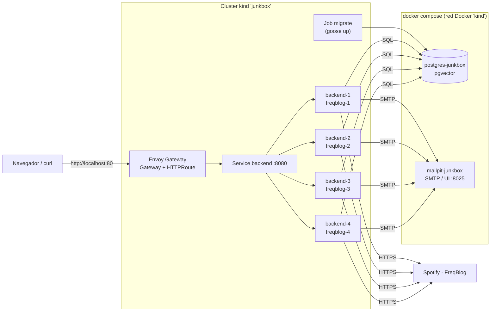

# Junkbox Backend

Backend para **Junkbox**: Plataforma web de reseñas musicales, calificaciones (1 a 5 estrellas), red social y sistema de recomendaciones personalizadas con búsqueda vectorial sobre un catálogo musical masivo.

Este servicio está construido en **Go** siguiendo los principios de arquitectura limpia / puertos y adaptadores (Clean Architecture), utilizando **PostgreSQL 16 + pgvector** para almacenamiento relacional y vectorial, **Goose** para control de versiones del esquema de base de datos, **SQLC** para generación de consultas SQL estrictamente tipadas en Go, y **Make** como herramienta de automatización para desarrollo y despliegue local.

---

## Dependencias Requeridas

### 1. Docker y Docker Compose

Requerido para orquestar el contenedor de base de datos PostgreSQL con soporte nativo de extensiones vectoriales (`pgvector`).

- **macOS / Windows**: Instalar [Docker Desktop](https://www.docker.com/products/docker-desktop/).
- **Linux**: Instalar Docker Engine y el plugin Docker Compose según la [documentación oficial](https://docs.docker.com/engine/install/).

Verificar instalación:

```bash
docker compose version
```

> **Imagen utilizada:** `pgvector/pgvector:pg16`. El volumen de datos asociado se denomina `postgres-junkbox-data`.

---

### 2. Goose (Migraciones de Base de Datos)

Herramienta de migraciones de base de datos en SQL puro:

```bash
go install github.com/pressly/goose/v3/cmd/goose@latest
```

Verificar que `$GOPATH/bin` esté en tu `$PATH`:

```bash
goose --version
```

---

### 3. SQLC (Compilador SQL a Go)

Generador de código Go tipo-seguro a partir de sentencias SQL nativas:

```bash
go install github.com/sqlc-dev/sqlc/cmd/sqlc@latest
```

Verificar instalación:

```bash
sqlc version
```

---

### 4. Make

#### macOS
```bash
# Vía CLI Tools de Xcode
xcode-select --install

# O vía Homebrew
brew install make
```

#### Linux
```bash
# Ubuntu / Debian
sudo apt update && sudo apt install make

# Fedora / RHEL
sudo dnf install make

# Arch Linux
sudo pacman -S make
```

#### Windows
Ejecutar PowerShell como Administrador:
```powershell
winget install GnuWin32.Make
# O mediante Chocolatey
choco install make
```

---

### 5. kind y kubectl (solo para el despliegue en Kubernetes)

[kind](https://kind.sigs.k8s.io/) levanta un cluster de Kubernetes local con contenedores Docker. `kubectl` es el cliente de Kubernetes e incluye Kustomize.

```bash
# macOS
brew install kind kubectl

# Linux / Windows: ver https://kind.sigs.k8s.io/docs/user/quick-start/#installation
#                  y https://kubernetes.io/docs/tasks/tools/
```

Verificar instalación:

```bash
kind version
kubectl version --client
```

---

## Configuración del Entorno de Base de Datos

1. Copia la plantilla de variables de entorno ubicada en `.env.template` hacia `.env`:

```bash
cp .env.template .env
```

2. Configura los parámetros en `.env`:

- `POSTGRES_DB`: Nombre de la base de datos principal (`junkbox_db`).
- `POSTGRES_USER`: Usuario administrador de PostgreSQL (`postgres`).
- `POSTGRES_PASSWORD`: Contraseña del usuario.
- `POSTGRES_PORT`: Puerto de conexión en el host (por defecto `5432`).
- `DATABASE_URL`: URL completa de conexión PostgreSQL utilizada por Goose y el servidor Go.
- `JWT_SECRET`: Secreto criptográfico HMAC-SHA256 (mínimo 32 caracteres) para firmar Access Tokens. Genera uno seguro con:
  ```bash
  openssl rand -hex 32
  ```
- `ACCESS_TOKEN_TTL` / `REFRESH_TOKEN_TTL`: vigencia de los tokens en formato de duración Go (por defecto `15m` y `168h`).
- `HTTP_ADDR`: dirección de escucha del servidor (por defecto `:8080`; también se puede pasar `--addr`).
- `SPOTIFY_CLIENT_ID` / `SPOTIFY_CLIENT_SECRET` (opcionales; se definen las dos o ninguna): credenciales de la app en el [Spotify Developer Dashboard](https://developer.spotify.com/dashboard), usadas con el flujo OAuth2 Client Credentials. Sin ellas, la búsqueda solo consulta el catálogo local.
- `FREQBLOG_API_KEY` (opcional): clave de [FreqBlog](https://freqblog.com), de donde salen los audio features de las canciones importadas desde Spotify. Spotify cerró `/v1/audio-features` para apps nuevas en noviembre de 2024. Sin la clave, esas canciones quedan sin embedding (`pending_embedding: true`). El plan gratuito incluye 1.000 canciones resueltas al mes.
- `SEARCH_FALLBACK_THRESHOLD` (opcional, por defecto `0.8`): puntaje mínimo (`strict_word_similarity`, de 0 a 1) del mejor resultado local para no consultar Spotify.
- `SEARCH_ENRICH_BUDGET` (opcional, por defecto `2s`): cuánto espera la búsqueda a Spotify para completar las imágenes de artista y las portadas que faltan. Lo que no termina a tiempo lo completa un worker en segundo plano.
- `CORS_ALLOWED_ORIGINS` (opcional, por defecto `http://localhost:5173`): orígenes del frontend, separados por coma, que pueden llamar a la API desde el navegador. Cada uno debe ser `http(s)://host[:puerto]` exacto, sin `/` final ni comodines; cualquier otro origen se rechaza.
- `FRONTEND_URL` (opcional, por defecto el primer origen de `CORS_ALLOWED_ORIGINS`): origen del frontend al que apuntan los enlaces de los correos (`/restablecer-contrasena#token=…` y `/verificar-correo#token=…`).
- `PASSWORD_RESET_TTL` / `EMAIL_VERIFICATION_TTL` (opcionales, por defecto `30m` y `24h`): vigencia de los enlaces de recuperación y de verificación.
- `MAIL_DRIVER` (opcional, por defecto `log`): `log` escribe los correos en la consola sin enviarlos; `smtp` los envía con la configuración `SMTP_*`.
- `MAIL_FROM` (obligatorio con `smtp`): remitente, p. ej. `JunkBox <no-reply@tu-dominio>`.
- `SMTP_HOST`, `SMTP_PORT` (por defecto `587`), `SMTP_USERNAME`, `SMTP_PASSWORD`, `SMTP_TLS` (`starttls` por defecto, `tls` o `none`): servidor SMTP. La plantilla trae activos los valores de Mailpit y comentados los de Resend.

> `.env` contiene secretos locales y está ignorado en Git mediante `.gitignore`.

> Si reutilizas un volumen `postgres-junkbox-data` ya inicializado, `POSTGRES_PASSWORD` (y la contraseña de `DATABASE_URL`) deben coincidir con la contraseña con la que se creó. Postgres ignora estas variables una vez que el volumen tiene datos.

---

## Gestión de Base de Datos (Make)

Todas las tareas operativas se gestionan desde la raíz del proyecto a través del `Makefile`:

### Ciclo de Vida del Contenedor Docker

- **Iniciar base de datos en segundo plano:**
  ```bash
  make db-up
  ```
  *(Espera a que el healthcheck de PostgreSQL confirme disponibilidad antes de devolver el control)*. También levanta **Mailpit**, un servidor SMTP falso que atrapa los correos del backend: no salen a Internet y se ven en http://localhost:8025.

- **Detener base de datos:**
  ```bash
  make db-down
  ```

- **Ver estado y salud del contenedor:**
  ```bash
  make db-ps
  ```

- **Inspeccionar registros (logs en vivo):**
  ```bash
  make db-logs
  ```

- **Acceder a consola interactiva `psql`:**
  ```bash
  make db-shell
  ```

- **Reinicio completo de base de datos (con confirmación interactiva de seguridad):**
  ```bash
  make db-reset
  ```
  > **Nota de Seguridad:** A diferencia de entornos volátiles, `make db-reset` solicita confirmación interactiva `[y/N]` antes de destruir el contenedor y el volumen de datos (`down -v`), protegiendo el catálogo de canciones indexadas.

---

## Control de Esquema: Migraciones (Goose)

- **Aplicar todas las migraciones pendientes:**
  ```bash
  make migrate-up
  ```

- **Revertir la última migración aplicada:**
  ```bash
  make migrate-down
  ```

- **Consultar estado actual de migraciones aplicadas:**
  ```bash
  make migrate-status
  ```

- **Crear una nueva migración:**
  ```bash
  make migrate-create name=nombre_de_la_migracion
  ```

---

## Poblado de Datos de Prueba (Seeding)

- **Crear un nuevo archivo de seed:**
  ```bash
  make seed-create name=nombre_del_seed
  ```

- **Aplicar todos los seeds ordenadamente:**
  ```bash
  make seed-up
  ```

- **Vaciar tablas respetando el historial de migraciones:**
  ```bash
  make seed-down
  ```
  *(Ejecuta `db/scripts/truncate_all.sql` solicitando confirmación del usuario)*.

---

## Generación de Código SQL (SQLC)

Compila las consultas SQL ubicadas en `db/queries/` contra el esquema de `db/migrations/` para generar código Go fuertemente tipado en `internal/store/sqlc/`:

```bash
make sqlc
```

---

## Reproducibilidad del Catálogo de Canciones (`song_metadata`)

El catálogo musical de Junkbox está en la tabla `song_metadata` (1.159.764 canciones), con vectores de características de audio (`vector(10)` en `pgvector`) para la búsqueda por similitud.

Para reconstruirlo en cualquier entorno limpio, sin copiar volúmenes Docker a mano:
1. Las migraciones crean `song_metadata`, `artists` y `albums`, la extensión `pg_trgm` para búsqueda difusa y los índices B-tree y trigrama.
2. `make ingest-songs` carga el CSV con SQL puro (`db/scripts/ingest_songs.sql`), sin dependencias de Python. Calcula los vectores con MinMax (loudness y tempo), crea los artistas, enlaza `song_metadata.artist_id` y construye los índices IVFFlat y de búsqueda. En un Postgres limpio tarda ~1 min 40 s:
   ```bash
   make migrate-up
   make ingest-songs                       # usa ./data/spotify_data.csv
   make ingest-songs DATASET=ruta/al.csv   # CSV en otra ubicación
   ```
3. Si el volumen ya tenía el catálogo de antes de la Fase 3, basta con `make migrate-up && make backfill-artists`. Es idempotente; la primera vez tarda ~2 min 15 s.
4. La carpeta `data/` con los CSV está en `.gitignore` y se distribuye por separado.
5. El pipeline está detallado en [`implementacion.md`](implementacion.md#28-especificación-del-pipeline-de-ingesta-desde-csv) y el backfill en [§4.2](implementacion.md#42-esquema-relacional-del-catálogo-musical).

> Ni el `Down` de las migraciones ni `make seed-down` eliminan `song_metadata`, `artists` o `albums`. El catálogo solo se destruye con `make db-reset`, que pide confirmación interactiva.

---

## Compilación y Ejecución del Servidor

- **Validar código (linter Go):**
  ```bash
  make vet
  ```

- **Ejecutar pruebas unitarias y de integración:**
  ```bash
  make test
  ```

- **Compilar binarios:**
  ```bash
  make build
  ```

- **Iniciar servidor API REST:**
  ```bash
  make run-server
  ```
  *(Ejecuta `go run . server --config .env`; por defecto escucha en `http://localhost:8080`)*.

---

## Puesta en Marcha Rápida

```bash
cp .env.template .env   # y ajustar contraseña, JWT_SECRET, credenciales de Spotify y FREQBLOG_API_KEY
make db-up
make migrate-up
make ingest-songs             # solo en una base de datos nueva (requiere data/spotify_data.csv)
make seed-up                  # 4 usuarios del equipo, contraseña Password123!
make run-server
```

Para levantar las 4 réplicas en Kubernetes, ver [Despliegue en Kubernetes (kind)](#despliegue-en-kubernetes-kind).

### Correos en producción (Resend)

En desarrollo los correos llegan a Mailpit (http://localhost:8025). Para enviarlos de verdad con [Resend](https://resend.com):

1. Verifica tu dominio en **Resend → Domains** y añade en su DNS los registros que indique (SPF y DKIM, de tipo `TXT`, y el `MX` del subdominio de envío).
2. Crea una API key con permiso solo de envío (**Sending access**).
3. En `.env`, comenta el bloque de Mailpit y descomenta el de Resend: `SMTP_HOST="smtp.resend.com"`, `SMTP_PORT=587`, `SMTP_USERNAME="resend"`, `SMTP_PASSWORD` con la API key, `SMTP_TLS="starttls"` y `MAIL_FROM` con una dirección de tu dominio.

Los correos se guardan en la tabla `email_outbox` dentro de la misma transacción que crea el token, y un worker los envía con reintentos (backoff de 30 s, 1 min, 2 min…; se descartan tras 5 intentos). Si el proveedor no está disponible, se entregan cuando vuelve.

---

## Despliegue en Kubernetes (kind)

Levanta **4 réplicas** del backend en un cluster local de [kind](https://kind.sigs.k8s.io/), detrás de [Envoy Gateway](https://gateway.envoyproxy.io/) (Gateway API). Cada réplica usa su propia `FREQBLOG_API_KEY`, y todas comparten el `JWT_SECRET` y la base de datos. Postgres y Mailpit siguen en docker compose, unidos a la red Docker `kind`. El detalle técnico y las decisiones están en `implementacion.md`, sección 8.



- **Envoy Gateway** recibe todo el tráfico HTTP en `localhost:80` y lo reparte entre los pods listos del Service `backend`. Cada respuesta trae el header `X-Instance` con el nombre del pod que atendió.
- **backend-1…4** son cuatro Deployments con la misma imagen. Solo cambia el Secret con la clave de FreqBlog.
- **El Job `migrate`** aplica las migraciones una sola vez antes de que arranquen las réplicas.
- **Coordinación entre réplicas:** los workers usan Postgres (`FOR UPDATE SKIP LOCKED`), así que ningún correo se envía dos veces y las réplicas no piden los mismos tracks a FreqBlog.

### 1. Configurar los secretos

```bash
cp deploy/k8s/secrets/common.env.template deploy/k8s/secrets/common.env
for n in 1 2 3 4; do cp deploy/k8s/secrets/freqblog.env.template deploy/k8s/secrets/freqblog-$n.env; done
```

Completar los archivos **sin comillas**:

- `common.env`: `JWT_SECRET` (`openssl rand -hex 32`), la contraseña de Postgres en `DATABASE_URL` y las credenciales de Spotify.
- `freqblog-N.env`: una `FREQBLOG_API_KEY` distinta en cada uno.

Git ignora estos archivos. La configuración no sensible (TTLs, CORS, Mailpit) está en `deploy/k8s/base/configmap.yaml`. Por eso `common.env` tiene menos campos que el `.env`:

- **Las variables `POSTGRES_*`** no pasan al cluster. Solo las usa el contenedor de Postgres; el backend se conecta con `DATABASE_URL`.
- **`SMTP_HOST`** cambia a `mailpit-junkbox`, porque dentro de un pod `localhost` es el propio pod.

La tabla completa con el destino de cada variable está en `implementacion.md`, sección 8.7.

> El `.env` y el ConfigMap son independientes: editar el `.env` no cambia el cluster. Tras editar `configmap.yaml`, ejecuta `make k8s-apply && make k8s-redeploy`. Tras editar un secreto, ejecuta `make k8s-secrets && make k8s-redeploy`.

### 2. Levantar todo

```bash
make k8s-up
```

Este comando:

1. Crea el cluster `junkbox` (1 control-plane + 2 workers) e instala Envoy Gateway.
2. Une Postgres y Mailpit a la red `kind` (el volumen del catálogo se conserva).
3. Construye y carga las imágenes `junkbox-backend:dev` y `junkbox-migrate:dev`.
4. Crea los Secrets, corre las migraciones y despliega las 4 réplicas.

La API queda en `http://localhost/api/v1` (puerto 80) y Mailpit en `http://localhost:8025`. Si es una base nueva, cargar el catálogo y los usuarios como siempre (`make ingest-songs`, `make seed-up`).

### 3. Operación

| Comando | Descripción |
|---|---|
| `make k8s-status` | Pods, Services, Gateway, HTTPRoute y Job. |
| `make k8s-logs` | Logs de las 4 réplicas, con prefijo por pod. |
| `make k8s-redeploy` | Tras cambiar el código: reconstruye y reinicia las réplicas de a una, sin cortar el servicio. |
| `make k8s-secrets` | Vuelve a cargar los Secrets (aplicar luego con `make k8s-redeploy`). |
| `make k8s-migrate` | Vuelve a correr `goose up` con el Job `migrate`. |
| `make k8s-down` | Borra el cluster. Postgres, Mailpit y el volumen del catálogo no se tocan. |

Para ver el balanceo y la recuperación ante fallos:

```bash
for i in $(seq 20); do curl -si http://localhost/healthz | grep -i x-instance; done | sort | uniq -c
kubectl --context kind-junkbox -n junkbox delete pod -l replica=2   # Kubernetes lo recrea solo
```

> **Nota:** `make k8s-status` muestra el Gateway con `PROGRAMMED False`. Es normal en kind (no hay LoadBalancer que le asigne una dirección): el tráfico entra por el NodePort publicado en `localhost:80`.
>
> `make k8s-deps` recrea los contenedores de Postgres y Mailpit para unirlos a la red `kind`. Un `make db-up` posterior los saca de esa red. Para volver a unirlos, ejecuta `make k8s-deps` otra vez.

---

## API REST

Base URL: `http://localhost:8080/api/v1` (con `make run-server`) o `http://localhost/api/v1` (en Kubernetes)

El backend utiliza tokens de acceso **JWT HS256** (15 minutos de vigencia) con claims `sub`, `username`, `jti`, `iat`, `exp`, y **Refresh Tokens** opacos (7 días de vigencia) con hash SHA-256 en base de datos, rotación por familias y denylist de revocación inmediata.

### Resumen de Endpoints

| Método | Ruta | Auth | Descripción |
|---|---|---|---|
| `GET` | `/healthz` (sin prefijo) | — | Comprobación de estado y conectividad del servicio |
| `POST` | `/api/v1/auth/register` | — | Registro público de nuevos usuarios |
| `POST` | `/api/v1/auth/login` | — | Inicio de sesión con correo o nombre de usuario |
| `POST` | `/api/v1/auth/refresh` | Bearer | Rotación e intercambio seguro de refresh token |
| `GET` | `/api/v1/auth/me` | Bearer | Consulta del perfil del usuario autenticado |
| `POST` | `/api/v1/auth/logout` | Bearer | Cierre de sesión y revocación en denylist |
| `POST` | `/api/v1/auth/password/forgot` | — | Solicitud de enlace de recuperación de contraseña |
| `POST` | `/api/v1/auth/password/reset` | Token del correo | Restablecimiento de contraseña con el enlace recibido |
| `POST` | `/api/v1/auth/email/verify` | Token del correo | Verificación del correo electrónico |
| `POST` | `/api/v1/auth/email/verify/resend` | Bearer | Reenvío del enlace de verificación |
| `GET` | `/api/v1/music/search` | Bearer | Búsqueda difusa en catálogo local con fallback a Spotify |
| `GET` | `/api/v1/music/tracks/{id}` | Bearer | Detalle de canción, métricas acústicas y estado de embedding |
| `GET` | `/api/v1/music/artists/{id}` | Bearer | Detalle de artista y catálogo relacionado |
| `GET` | `/api/v1/music/albums/{id}` | Bearer | Detalle de álbum y pistas asociadas |
| `POST` | `/api/v1/ratings` | Bearer | Asigna o reemplaza el voto del usuario (0.5 a 5.0 en pasos de 0.5) |
| `GET` | `/api/v1/ratings/my` | Bearer | Voto del usuario autenticado sobre una canción, álbum o artista |
| `DELETE` | `/api/v1/ratings/{id}` | Bearer | Elimina un voto del usuario |
| `POST` | `/api/v1/reviews` | Bearer | Publica la reseña del usuario (una por objetivo) |
| `GET` | `/api/v1/reviews` | Bearer | Reseñas de una canción, álbum o artista, paginadas |
| `GET` | `/api/v1/reviews/{id}` | Bearer | Detalle de una reseña con su autor y el voto del autor |
| `PUT` | `/api/v1/reviews/{id}` | Bearer | Edita una reseña del usuario |
| `DELETE` | `/api/v1/reviews/{id}` | Bearer | Elimina una reseña del usuario |

---

### Detalle de Endpoints y Ejemplos de Uso

#### 1. Healthcheck (`GET /healthz`)
Verifica que el servidor esté activo y respondiendo.

```bash
curl -i -X GET http://localhost:8080/healthz
```

**Respuesta (`200 OK`):**
```text
ok
```

---

#### 2. Registro de Usuario (`POST /api/v1/auth/register`)
Crea una nueva cuenta de usuario en la plataforma. Emite un par inicial de tokens y el perfil.

**Cuerpo de la petición (JSON):**
- `username` (string, obligatorio): Nombre de usuario único (handle).
- `email` (string, obligatorio): Correo electrónico válido y único.
- `password` (string, obligatorio): Contraseña de mínimo 8 caracteres que incluya letras, números y caracteres especiales (máximo 72 bytes).
- `display_name` (string, opcional): Nombre visible.
- `avatar_url` (string, opcional): Enlace a imagen de perfil.

```bash
curl -i -X POST http://localhost:8080/api/v1/auth/register \
  -H "Content-Type: application/json" \
  -d '{
    "username": "melomano_pro",
    "email": "melomano@junkbox.local",
    "password": "Password123!",
    "display_name": "Crítico Musical",
    "avatar_url": "https://api.dicebear.com/7.x/bottts/svg?seed=melomano"
  }'
```

**Respuesta (`201 Created`):**
```json
{
  "access_token": "eyJhbGciOiJIUzI1NiIsInR5cCI6IkpXVCJ9...",
  "refresh_token": "63f7b2c5897914de42f10b7593...",
  "expires_in": 900,
  "user": {
    "id": "e43b1234-abcd-4def-9123-123456789abc",
    "username": "melomano_pro",
    "email": "melomano@junkbox.local",
    "display_name": "Crítico Musical",
    "avatar_url": "https://api.dicebear.com/7.x/bottts/svg?seed=melomano",
    "email_verified": false,
    "created_at": "2026-10-31T12:00:00Z"
  }
}
```

---

#### 3. Inicio de Sesión (`POST /api/v1/auth/login`)
Autentica con contraseña y permite identificarse mediante `username` o `email`.

**Cuerpo de la petición (JSON):**
- `identifier` (string, obligatorio): Nombre de usuario o correo electrónico.
- `password` (string, obligatorio): Contraseña.

```bash
curl -i -X POST http://localhost:8080/api/v1/auth/login \
  -H "Content-Type: application/json" \
  -d '{
    "identifier": "cesar_beltran",
    "password": "Password123!"
  }'
```

**Respuesta (`200 OK`):**
```json
{
  "access_token": "eyJhbGciOiJIUzI1NiIsInR5cCI6IkpXVCJ9...",
  "refresh_token": "a89d71b30ef28c8942ba64e29...",
  "expires_in": 900,
  "user": {
    "id": "b1000000-0000-0000-0000-000000000001",
    "username": "cesar_beltran",
    "email": "cesar@junkbox.local",
    "display_name": "César David Beltrán Loredo",
    "avatar_url": "https://api.dicebear.com/7.x/bottts/svg?seed=cesar",
  "email_verified": true,
    "email_verified": true,
    "created_at": "2026-10-27T00:00:00Z"
  }
}
```

---

#### 4. Rotación de Refresh Token (`POST /api/v1/auth/refresh`)
Rota el refresh token y renueva el access token. Requiere enviar el access token anterior (la llave vieja, aunque esté expirada) en la cabecera `Authorization`.

**Cuerpo de la petición (JSON):**
- `refresh_token` (string, obligatorio): Token de refresco opaco.

```bash
curl -i -X POST http://localhost:8080/api/v1/auth/refresh \
  -H "Authorization: Bearer $ACCESS_TOKEN" \
  -H "Content-Type: application/json" \
  -d '{
    "refresh_token": "a89d71b30ef28c8942ba64e29..."
  }'
```

**Respuesta (`200 OK`):**
```json
{
  "access_token": "eyJhbGciOiJIUzI1NiIsInR5cCI6IkpXVCJ9_nuevo...",
  "refresh_token": "f29b47a11c875d9e034ac1258_nuevo...",
  "expires_in": 900
}
```

---

#### 5. Perfil de Usuario Autenticado (`GET /api/v1/auth/me`)
Devuelve la información del usuario autenticado a partir de su JWT.

```bash
curl -i -X GET http://localhost:8080/api/v1/auth/me \
  -H "Authorization: Bearer $ACCESS_TOKEN"
```

**Respuesta (`200 OK`):**
```json
{
  "id": "b1000000-0000-0000-0000-000000000001",
  "username": "cesar_beltran",
  "email": "cesar@junkbox.local",
  "display_name": "César David Beltrán Loredo",
  "avatar_url": "https://api.dicebear.com/7.x/bottts/svg?seed=cesar",
  "created_at": "2026-10-27T00:00:00Z"
}
```

---

#### 6. Cierre de Sesión (`POST /api/v1/auth/logout`)
Invalida el access token actual en la denylist y revoca el refresh token. Con `all_sessions: true`, invalida todas las sesiones del usuario mediante corte global.

**Cuerpo de la petición (JSON):**
- `refresh_token` (string, obligatorio): Token de refresco de la sesión.
- `all_sessions` (boolean, opcional, por defecto `false`): Si es `true`, cierra todas las sesiones activas del usuario.

```bash
curl -i -X POST http://localhost:8080/api/v1/auth/logout \
  -H "Authorization: Bearer $ACCESS_TOKEN" \
  -H "Content-Type: application/json" \
  -d '{
    "refresh_token": "f29b47a11c875d9e034ac1258...",
    "all_sessions": false
  }'
```

**Respuesta (`200 OK`):**
```json
{
  "message": "sesión cerrada"
}
```

---

#### 7. Recuperación de Contraseña (`POST /api/v1/auth/password/forgot`)
Envía un enlace de recuperación al correo si pertenece a una cuenta. Responde **siempre** igual, exista o no el correo, para no revelar qué cuentas están registradas. Se emiten como máximo 3 enlaces por usuario y hora; uno nuevo invalida los anteriores.

**Cuerpo de la petición (JSON):**
- `email` (string, obligatorio): Correo de la cuenta.

```bash
curl -i -X POST http://localhost:8080/api/v1/auth/password/forgot \
  -H "Content-Type: application/json" \
  -d '{ "email": "cesar@junkbox.local" }'
```

**Respuesta (`200 OK`):**
```json
{
  "message": "Si el correo está registrado, recibirás un enlace para restablecer tu contraseña."
}
```

El correo lleva un enlace a `FRONTEND_URL/restablecer-contrasena#token=…`, válido 30 minutos y de un solo uso. El token va en el fragmento (`#`) para que no llegue a logs de servidor ni al `Referer`; el frontend lo lee y lo envía al endpoint siguiente.

---

#### 8. Restablecimiento de Contraseña (`POST /api/v1/auth/password/reset`)
Cambia la contraseña con el token del enlace. Además, marca el correo como verificado, **cierra todas las sesiones** del usuario (refresh tokens y access tokens) y le envía un aviso de que su contraseña cambió.

**Cuerpo de la petición (JSON):**
- `token` (string, obligatorio): Token del enlace del correo.
- `password` (string, obligatorio): Nueva contraseña, con las mismas reglas que en el registro.

```bash
curl -i -X POST http://localhost:8080/api/v1/auth/password/reset \
  -H "Content-Type: application/json" \
  -d '{ "token": "FU76CQGYHVzfD3R7KObJ...", "password": "NuevaClave9$" }'
```

**Respuestas:**
- `200 OK`: `{ "message": "Contraseña actualizada. Inicia sesión de nuevo." }`
- `400 Bad Request`: la contraseña no cumple las reglas. El token no se consume.
- `401 Unauthorized`: `{ "error": "token inválido o expirado" }` (no existe, ya se usó o caducó).

---

#### 9. Verificación de Correo (`POST /api/v1/auth/email/verify`)
Al registrarse, el usuario recibe un enlace a `FRONTEND_URL/verificar-correo#token=…`, válido 24 horas. La verificación **no bloquea** el inicio de sesión: el estado se expone como `email_verified` en el perfil.

```bash
curl -i -X POST http://localhost:8080/api/v1/auth/email/verify \
  -H "Content-Type: application/json" \
  -d '{ "token": "r7Bi4G3vwt..." }'
```

**Respuestas:**
- `200 OK`: `{ "message": "Correo verificado." }`
- `401 Unauthorized`: `{ "error": "token inválido o expirado" }`

---

#### 10. Reenvío de Verificación (`POST /api/v1/auth/email/verify/resend`)
Envía un nuevo enlace de verificación al usuario autenticado. Si ya está verificado, o si superó el límite de 3 enlaces por hora, responde igual sin enviar nada.

```bash
curl -i -X POST http://localhost:8080/api/v1/auth/email/verify/resend \
  -H "Authorization: Bearer $ACCESS_TOKEN"
```

**Respuesta (`200 OK`):**
```json
{
  "message": "Si tu correo aún no está verificado, recibirás un nuevo enlace."
}
```

---

#### 11. Búsqueda de Música (`GET /api/v1/music/search`)
Busca por coincidencia difusa de palabras (`pg_trgm`, `strict_word_similarity` sobre "título + artista") en la base de datos local.

Consulta a Spotify si no hay resultados locales o si el mejor puntaje es menor que `SEARCH_FALLBACK_THRESHOLD` (0.8). En ese caso guarda las canciones, artistas y álbumes en PostgreSQL y encola las canciones nuevas para calcular su vector de recomendaciones en segundo plano.

Si Spotify falla o no está configurado, responde los resultados locales que haya.

Cada canción trae `album_image_url` (portada) y `artist_image_url`, y cada artista su `image_url`. Si faltan en el catálogo, la búsqueda las pide a Spotify antes de responder, en paralelo y con un tope de `SEARCH_ENRICH_BUDGET` (2 s):
- los artistas que llegaron "simplificados" (sin imagen) se completan con `GET /v1/artists/{id}`;
- las canciones del CSV, que no tienen álbum, se enlazan con `GET /v1/tracks/{id}`. Eso trae la portada y reclama a su artista.

Spotify eliminó los endpoints por lotes para las apps en Development Mode, así que es una llamada por artista o canción. Solo ocurre la primera vez: el resultado queda guardado. Lo que no alcanza a resolverse dentro del presupuesto sale en `null` y lo completa un worker en segundo plano para la siguiente búsqueda.

Las consultas de título y/o artista responden en 15–250 ms. Una sola palabra muy común ("love", "the") puede tardar 1–3 s; la limitación y sus alternativas están en [`implementacion.md` §4.1](implementacion.md#41-arquitectura-del-flujo-de-búsqueda-y-fallback-cache-through).

**Parámetros de consulta (Query params):**
- `q` (string, obligatorio): Texto a buscar (ej. título de canción, nombre de artista o álbum).
- `type` (string, opcional, por defecto `track`): Tipo de entidad: `track`, `artist` o `album`.
- `limit` (int, opcional, por defecto `20`, máx. `50`).

##### Ejemplo A: Coincidencia en Catálogo Local (Cache-Hit)
```bash
curl -i -X GET "http://localhost:8080/api/v1/music/search?q=Grain%20Dan%20Telfer&type=track&limit=1" \
  -H "Authorization: Bearer $ACCESS_TOKEN"
```

**Respuesta (`200 OK`):**
```json
{
  "source": "local_cache",
  "query": "Grain Dan Telfer",
  "type": "track",
  "count": 1,
  "results": [
    {
      "id": 10924,
      "spotify_id": "1TIHAkrLbRALyt4O4Oh28i",
      "track_name": "Grain",
      "artist_name": "Dan Telfer",
      "album_title": "Fiddling As Mammoths Burn",
      "album_image_url": "https://i.scdn.co/image/ab67616d0000b273...",
      "artist_image_url": "https://i.scdn.co/image/ab6761610000e5eb...",
      "year": 2012,
      "genre": "comedy",
      "popularity": 5,
      "duration_ms": 352307,
      "has_embedding": true,
      "pending_embedding": false
    }
  ]
}
```

##### Ejemplo B: Canción Nueva / No Existente Localmente (Cache-Miss con Fallback a Spotify)

Localmente solo hay otras canciones de la artista (puntaje 0.67 < 0.8). Spotify ya no envía `popularity` a las apps en Development Mode, y sus tracks no traen género.
```bash
curl -i -X GET "http://localhost:8080/api/v1/music/search?q=Espresso%20Sabrina%20Carpenter&type=track" \
  -H "Authorization: Bearer $ACCESS_TOKEN"
```

**Respuesta (`200 OK`):**
```json
{
  "source": "spotify_fallback",
  "query": "Espresso Sabrina Carpenter",
  "type": "track",
  "count": 1,
  "results": [
    {
      "id": 1159765,
      "spotify_id": "2qSkXiYOKEzfk3vhRpIQUR",
      "track_name": "Espresso",
      "artist_name": "Sabrina Carpenter",
      "album_title": "Short n' Sweet",
      "album_image_url": "https://i.scdn.co/image/ab67616d0000b273...",
      "artist_image_url": "https://i.scdn.co/image/ab6761610000e5eb...",
      "year": 2024,
      "genre": null,
      "popularity": null,
      "duration_ms": 175459,
      "has_embedding": false,
      "pending_embedding": true
    }
  ]
}
```

---

#### 12. Detalle de Canción (`GET /api/v1/music/tracks/{id}`)
Devuelve los metadatos completos de una canción: atributos acústicos y si ya tiene vector de recomendación (`has_embedding`).

El parámetro `{id}` puede ser el ID de Spotify o el ID entero local. `audio_features` es `null` mientras la canción no tenga ninguno. `ratings` resume las calificaciones de los usuarios: `average` es `null` mientras no haya votos (ver endpoint 15).

En las canciones importadas desde Spotify, los atributos vienen de FreqBlog: `speechiness`, `liveness` y `time_signature` quedan en `null`, porque FreqBlog no los mide, y en el vector se usa la mediana del catálogo.

```bash
curl -i -X GET "http://localhost:8080/api/v1/music/tracks/2qSkXiYOKEzfk3vhRpIQUR" \
  -H "Authorization: Bearer $ACCESS_TOKEN"
```

**Respuesta (`200 OK`):**
```json
{
  "id": 1159765,
  "spotify_id": "2qSkXiYOKEzfk3vhRpIQUR",
  "track_name": "Espresso",
  "artist_name": "Sabrina Carpenter",
  "album_title": "Short n' Sweet",
  "year": 2024,
  "genre": null,
  "popularity": null,
  "duration_ms": 175459,
  "has_embedding": true,
  "pending_embedding": false,
  "artist_id": "c1000000-0000-0000-0000-000000000001",
  "album_id": "d1000000-0000-0000-0000-000000000001",
  "isrc": "USUM72401994",
  "audio_features": {
    "danceability": 0.70,
    "energy": 0.77,
    "key": 0,
    "loudness": -5.48,
    "mode": 1,
    "speechiness": null,
    "acousticness": 0.11,
    "instrumentalness": 0.0,
    "liveness": null,
    "valence": 0.69,
    "tempo": 104.0,
    "time_signature": null
  },
  "ratings": { "count": 2, "average": 4.25 }
}
```

---

#### 13. Detalle de Artista (`GET /api/v1/music/artists/{id}`)
Obtiene los datos del artista (géneros, popularidad, imagen y `ratings`) por ID de Spotify o UUID local. Los artistas que vienen del CSV no tienen `spotify_id` hasta que una búsqueda en Spotify los "reclama" por nombre. `popularity` es `null` si Spotify no la envía.

```bash
curl -i -X GET "http://localhost:8080/api/v1/music/artists/74KM79TiuVKeVCqs8QtB0B" \
  -H "Authorization: Bearer $ACCESS_TOKEN"
```

**Respuesta (`200 OK`):**
```json
{
  "id": "c1000000-0000-0000-0000-000000000001",
  "spotify_id": "74KM79TiuVKeVCqs8QtB0B",
  "name": "Sabrina Carpenter",
  "genres": ["dance pop", "pop"],
  "popularity": null,
  "image_url": "https://i.scdn.co/image/ab6761610000e5eb...",
  "created_at": "2026-10-31T12:00:00Z",
  "ratings": { "count": 0, "average": null }
}
```

---

#### 14. Detalle de Álbum (`GET /api/v1/music/albums/{id}`)
Obtiene los datos del álbum, su carátula, su artista, sus `ratings` y sus pistas (las que ya están en el catálogo local), por ID de Spotify o UUID local.

```bash
curl -i -X GET "http://localhost:8080/api/v1/music/albums/2lIZef49vdWi0LMePaA4Sp" \
  -H "Authorization: Bearer $ACCESS_TOKEN"
```

**Respuesta (`200 OK`):**
```json
{
  "id": "d1000000-0000-0000-0000-000000000001",
  "spotify_id": "2lIZef49vdWi0LMePaA4Sp",
  "title": "Short n' Sweet",
  "artist_id": "c1000000-0000-0000-0000-000000000001",
  "artist_name": "Sabrina Carpenter",
  "release_year": 2024,
  "album_type": "album",
  "image_url": "https://i.scdn.co/image/ab67616d0000b273...",
  "total_tracks": 12,
  "created_at": "2026-10-31T12:00:00Z",
  "ratings": { "count": 1, "average": 5.0 },
  "tracks": [
    {
      "id": 1159765,
      "spotify_id": "2qSkXiYOKEzfk3vhRpIQUR",
      "track_name": "Espresso",
      "artist_name": "Sabrina Carpenter",
      "album_title": "Short n' Sweet",
      "year": 2024,
      "genre": null,
      "popularity": null,
      "duration_ms": 175459,
      "has_embedding": true,
      "pending_embedding": false
    }
  ]
}
```

---

#### 15. Asignar o Editar Calificación (`POST /api/v1/ratings`)
Asigna o reemplaza el voto del usuario sobre una canción, un álbum o un artista. Cada usuario tiene un solo voto por objetivo: votar de nuevo reemplaza el puntaje (`UPSERT`). Un trigger de PostgreSQL actualiza `ratings.count` y `ratings.average` del objetivo en la misma transacción.

**Cuerpo de la petición (JSON):**
- `target_type` (string, obligatorio): `"song"`, `"album"` o `"artist"`.
- `target_id` (string, obligatorio): el mismo formato que el detalle del catálogo: ID entero local o ID de Spotify (canciones), y UUID local o ID de Spotify (álbumes y artistas). El objetivo debe existir en el catálogo local; un ID de Spotify nunca importado devuelve `404`.
- `score` (number, obligatorio): de `0.5` a `5.0` en incrementos de `0.5` (medias estrellas).

```bash
curl -i -X POST http://localhost:8080/api/v1/ratings \
  -H "Authorization: Bearer $ACCESS_TOKEN" \
  -H "Content-Type: application/json" \
  -d '{
    "target_type": "song",
    "target_id": "10924",
    "score": 4.5
  }'
```

**Respuesta (`201 Created` si el voto es nuevo, `200 OK` si reemplaza uno anterior):**
```json
{
  "id": "e5000000-0000-0000-0000-000000000001",
  "user_id": "b1000000-0000-0000-0000-000000000001",
  "target": { "type": "song", "id": "10924" },
  "score": 4.5,
  "created_at": "2026-11-04T12:00:00Z",
  "updated_at": "2026-11-04T12:00:00Z"
}
```

`target.id` es siempre el ID local, aunque la petición haya usado el de Spotify.

---

#### 16. Consultar Mi Calificación (`GET /api/v1/ratings/my`)
Obtiene el voto del usuario autenticado sobre un objetivo. Recibe `target_type` y `target_id` como query params, con el mismo formato que en el endpoint 15. Si el usuario no ha calificado ese objetivo, responde `404`.

```bash
curl -i -X GET "http://localhost:8080/api/v1/ratings/my?target_type=song&target_id=10924" \
  -H "Authorization: Bearer $ACCESS_TOKEN"
```

**Respuesta (`200 OK`):** el mismo objeto que devuelve el endpoint 15.

---

#### 17. Eliminar Calificación (`DELETE /api/v1/ratings/{id}`)
Elimina un voto del usuario autenticado; el trigger lo descuenta de las estadísticas. Las reseñas del usuario sobre ese objetivo se conservan y pasan a mostrar `rating_score: null`. Responde `403` si el voto es de otro usuario y `404` si no existe.

```bash
curl -i -X DELETE http://localhost:8080/api/v1/ratings/e5000000-0000-0000-0000-000000000001 \
  -H "Authorization: Bearer $ACCESS_TOKEN"
```

**Respuesta (`200 OK`):**
```json
{
  "message": "calificación eliminada"
}
```

---

#### 18. Publicar Reseña (`POST /api/v1/reviews`)
Publica la reseña del usuario sobre una canción, un álbum o un artista. Se puede reseñar sin calificar. El puntaje que acompaña a la reseña (`rating_score`) es el voto actual del autor sobre el mismo objetivo, o `null` si no lo ha calificado. Cada usuario puede publicar una sola reseña por objetivo: una segunda responde `409`, y para cambiarla se usa el endpoint 21.

**Cuerpo de la petición (JSON):**
- `target_type` (string, obligatorio): `"song"`, `"album"` o `"artist"`.
- `target_id` (string, obligatorio): el mismo formato que en el endpoint 15.
- `title` (string, opcional): máximo 200 caracteres. Si se omite o va vacío, la reseña queda sin título.
- `content` (string, obligatorio): de 5 a 5000 caracteres, sin contar los espacios de los extremos (se recortan).

```bash
curl -i -X POST http://localhost:8080/api/v1/reviews \
  -H "Authorization: Bearer $ACCESS_TOKEN" \
  -H "Content-Type: application/json" \
  -d '{
    "target_type": "song",
    "target_id": "10924",
    "title": "Excelente pieza",
    "content": "Una interpretación magnífica y un ritmo impecable."
  }'
```

**Respuesta (`201 Created`):**
```json
{
  "id": "f5000000-0000-0000-0000-000000000001",
  "target": { "type": "song", "id": "10924" },
  "title": "Excelente pieza",
  "content": "Una interpretación magnífica y un ritmo impecable.",
  "rating_score": 4.5,
  "likes_count": 0,
  "author": {
    "id": "b1000000-0000-0000-0000-000000000001",
    "username": "cesar_beltran",
    "display_name": "César David Beltrán Loredo",
    "avatar_url": "https://api.dicebear.com/7.x/bottts/svg?seed=cesar"
  },
  "created_at": "2026-11-04T12:00:00Z",
  "updated_at": "2026-11-04T12:00:00Z"
}
```

`likes_count` está reservado para una fase futura y por ahora siempre vale `0`. Los endpoints 18, 20 y 21 devuelven este mismo objeto.

---

#### 19. Listar Reseñas de un Objetivo (`GET /api/v1/reviews`)
Devuelve las reseñas de una canción, un álbum o un artista, de la más reciente a la más antigua.

**Parámetros de consulta (Query params):**
- `target_type` (string, obligatorio): `"song"`, `"album"` o `"artist"`.
- `target_id` (string, obligatorio): el mismo formato que en el endpoint 15.
- `limit` (int, opcional): de 1 a 50; por defecto `20`.
- `page` (int, opcional): empieza en 1; por defecto `1`.

```bash
curl -i -X GET "http://localhost:8080/api/v1/reviews?target_type=song&target_id=10924&limit=10&page=1" \
  -H "Authorization: Bearer $ACCESS_TOKEN"
```

**Respuesta (`200 OK`):** `count` es el número de reseñas de esta página y `total` el de todas las del objetivo.
```json
{
  "target": { "type": "song", "id": "10924" },
  "page": 1,
  "limit": 10,
  "count": 1,
  "total": 1,
  "reviews": [
    {
      "id": "f5000000-0000-0000-0000-000000000001",
      "target": { "type": "song", "id": "10924" },
      "title": "Excelente pieza",
      "content": "Una interpretación magnífica y un ritmo impecable.",
      "rating_score": 4.5,
      "likes_count": 0,
      "author": {
        "id": "b1000000-0000-0000-0000-000000000001",
        "username": "cesar_beltran",
        "display_name": "César David Beltrán Loredo",
        "avatar_url": "https://api.dicebear.com/7.x/bottts/svg?seed=cesar"
      },
      "created_at": "2026-11-04T12:00:00Z",
      "updated_at": "2026-11-04T12:00:00Z"
    }
  ]
}
```

---

#### 20. Detalle de Reseña (`GET /api/v1/reviews/{id}`)
Consulta una reseña por su UUID.

```bash
curl -i -X GET http://localhost:8080/api/v1/reviews/f5000000-0000-0000-0000-000000000001 \
  -H "Authorization: Bearer $ACCESS_TOKEN"
```

**Respuesta (`200 OK`):** el mismo objeto que devuelve el endpoint 18.

---

#### 21. Editar Reseña (`PUT /api/v1/reviews/{id}`)
Reemplaza el título y el contenido de una reseña, con las mismas reglas que el endpoint 18. Si se omite `title`, la reseña queda sin título. Solo puede editarla su autor (`403` en otro caso).

```bash
curl -i -X PUT http://localhost:8080/api/v1/reviews/f5000000-0000-0000-0000-000000000001 \
  -H "Authorization: Bearer $ACCESS_TOKEN" \
  -H "Content-Type: application/json" \
  -d '{
    "title": "Excelente pieza (actualizada)",
    "content": "Tras escucharla varias veces más, sigue siendo una joya inolvidable."
  }'
```

**Respuesta (`200 OK`):** la reseña completa, con el mismo formato que el endpoint 18 y `updated_at` actualizado.

---

#### 22. Eliminar Reseña (`DELETE /api/v1/reviews/{id}`)
Elimina una reseña del usuario autenticado. Responde `403` si la reseña es de otro usuario y `404` si no existe.

```bash
curl -i -X DELETE http://localhost:8080/api/v1/reviews/f5000000-0000-0000-0000-000000000001 \
  -H "Authorization: Bearer $ACCESS_TOKEN"
```

**Respuesta (`200 OK`):**
```json
{
  "message": "reseña eliminada"
}
```

---

### Formato Estándar de Errores

Todas las respuestas con error devuelven formato JSON uniforme:

```json
{
  "error": "descripción legible del error"
}
```

- `400 Bad Request`: parámetros faltantes, JSON malformado (incluidos campos desconocidos) o campos con formato inválido (p. ej. `type` distinto de `track`/`artist`/`album`, `target_type` distinto de `song`/`album`/`artist`, `limit` fuera de 1–50, un `{id}` o `target_id` que no es ni un ID local ni un ID de Spotify, `score` fuera de 0.5–5.0 o que no es múltiplo de 0.5, o `content` de reseña fuera de 5–5000 caracteres).
- `401 Unauthorized`: Token ausente, firma expirada, token en denylist, refresh token ya utilizado, o token de correo (recuperación/verificación) inválido, usado o expirado.
- `403 Forbidden`: intento de editar o borrar una calificación o reseña de otro usuario.
- `404 Not Found`: canción, artista, álbum, calificación o reseña no encontrada (incluye un `target_id` de Spotify que no está en el catálogo local y `GET /ratings/my` sin voto).
- `409 Conflict`: `username` o `email` ya registrado, o segunda reseña del mismo usuario sobre el mismo objetivo.
- `500 Internal Server Error`: fallo de conexión con la base de datos u otro error interno.
- `502 Bad Gateway`: no hay resultados locales y Spotify falló (`servicio de música no disponible`).

Para una guía de verificación completa paso a paso con scripts automatizados de prueba, consulta [`implementacion.md`](implementacion.md#7-guía-de-verificación-y-pruebas-con-curl).
